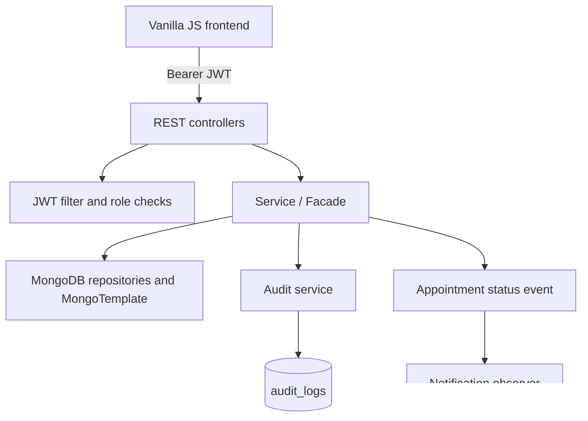

# SecureCare — Hospital Management System

SecureCare is a Java 17 / Spring Boot 4 / MongoDB hospital management application with JWT authentication, role-aware access, an audit trail, and a vanilla JavaScript interface.

## Technology

- Java 17, Spring Boot 4, Spring Web MVC, Spring Data MongoDB
- Spring Security, JWT (JJWT), BCrypt
- MongoDB 7, indexed collections and a 90-day audit TTL index
- HTML5, CSS3 and vanilla JavaScript (no frontend framework)
- Maven, JUnit 5, JaCoCo

## Architecture



The application follows a layered Controller → Service → Repository/MongoDB structure. Domain documents are in `domain/model`, enums in `domain/enums`, and persistence interfaces in `repository`.

## Implemented modules

- Login with signed JWT, BCrypt verification and per-IP in-memory throttling (5 failures per 60 seconds).
- Admin-only user provisioning and account activation/deactivation.
- Role-aware CRUD endpoints for patients, doctors, appointments, prescriptions, medical records, wards, admissions and billing.
- Appointment status transition validation.
- Audit logging on create/update/delete, with a MongoDB 90-day TTL index.
- Dashboard aggregate counts and recent audit events.
- Global error response shape: `code`, `message`, `timestamp`, `path`.
- Responsive dashboard, login, tables, record forms, search, edit/delete and toast feedback.

## Roles

| Role | Permissions |
|---|---|
| ADMIN | All resources, user administration, audit logs |
| DOCTOR | Read permitted resources; create/update prescriptions and medical records |
| NURSE | Read permitted resources; create/update medical records and admissions |
| RECEPTIONIST | Patients, appointments, admissions and billing; read prescriptions |

## Design patterns demonstrated

- **Strategy:** `PricingStrategy` with `StandardAppointmentPricing`.
- **Observer:** `AppointmentStatusChangedEvent` and `AppointmentNotificationListener`.
- **Factory:** `AppointmentFactory` supplies consistent appointment defaults.
- **State:** `AppointmentStateMachine` restricts status transitions.
- **Builder:** `PatientDraft.Builder` assembles a patient intake object.
- **Repository:** Spring Data MongoDB repository interfaces.
- **Singleton:** Spring-managed services/components.
- **Facade:** `ResourceService` coordinates persistence, validation, authorization and audit operations.

## Run locally

### Prerequisites

- JDK 17 or newer (project target is Java 17)
- Maven 3.9+
- Docker with Compose, or a local MongoDB 7 instance

### 1. Configure environment

Copy `.env.example` to `.env` and set a strong secret. Generate one with:

```bash
openssl rand -base64 48
```

Set `JWT_SECRET` to that generated value. Also set a unique admin username and a password of at least 12 characters. Never commit `.env`.

Export variables into your shell (or use your preferred environment-variable manager):

```bash
set -a && source .env && set +a
```

### Option A: run the complete stack with Docker

After creating `.env` and setting the required values, run:

```bash
docker compose up --build -d
```

Open `http://localhost:5500`; the API is at `http://localhost:8080`. View logs with `docker compose logs -f backend`.

### Option B: run services locally

Start MongoDB:

```bash
docker compose up -d mongodb
```

### 3. Start the backend

```bash
mvn clean test
mvn spring-boot:run
```

Backend: `http://localhost:8080`

Health: `http://localhost:8080/api/health`

### 4. Open frontend

Serve the `frontend` directory on port 5500, for example:

```bash
python3 -m http.server 5500 --directory frontend
```

Open `http://localhost:5500` and sign in with the bootstrap administrator configured in environment variables.

## API examples

Login:

```bash
curl -X POST http://localhost:8080/api/auth/login \
  -H 'Content-Type: application/json' \
  -d '{"username":"admin","password":"YOUR_PASSWORD"}'
```

Create patient (use the returned token):

```bash
curl -X POST http://localhost:8080/api/patients \
  -H "Authorization: Bearer $TOKEN" -H 'Content-Type: application/json' \
  -d '{"patientId":"PAT-1001","name":"Example Patient","dateOfBirth":"1990-01-01","gender":"Other","bloodType":"O+","allergies":[],"contact":{"phone":"+256700000000","email":"patient@example.test","address":"Kampala"}}'
```

List patients:

```bash
curl http://localhost:8080/api/patients -H "Authorization: Bearer $TOKEN"
```

Update/delete use `PUT /api/{resource}/{id}` and `DELETE /api/{resource}/{id}`. Full endpoint outline is in `docs/openapi.yaml`.

## API route summary

| Method | Endpoint | Access |
|---|---|---|
| POST | `/api/auth/login` | Public, rate limited |
| GET | `/api/health` | Public |
| GET | `/api/dashboard` | Authenticated |
| GET/POST | `/api/{patients,doctors,appointments,prescriptions,medical-records,wards,admissions,billing}` | Authenticated; role checked per resource |
| GET/PUT/DELETE | `/api/{resource}/{id}` | Authenticated; role checked per resource |
| GET | `/api/audit-logs` | ADMIN |
| GET/POST | `/api/users` or `/api/admin/users` | ADMIN |
| GET | `/api/users/{id}` or `/api/admin/users/{id}` | ADMIN |
| PATCH | `/api/users/{id}` or `/api/admin/users/{id}` | ADMIN |
| DELETE | `/api/users/{id}` or `/api/admin/users/{id}` (soft deactivate) | ADMIN |
| PATCH | `/api/users/{id}/active` | ADMIN |
| PATCH | `/api/users/{id}/ownership` | ADMIN |
| GET | `/api/me` (also `/api/users/me`) | Authenticated |
| POST | `/api/pricing/appointment` | Authenticated |

## User Management

Administrators can list users with `GET /api/users`, create users with `POST /api/users`, and retrieve a user by ID with `GET /api/users/{id}`. `PATCH /api/users/{id}` partially updates `email`, `role`, and `active`; attempts to provide `username` or `passwordHash` are rejected. `DELETE /api/users/{id}` deactivates the account and returns no content; it never hard-deletes a user, and the last active administrator cannot be deactivated. `GET /api/me` returns the authenticated user's profile. User responses do not include password hashes.

The user model has no separate display name, so the Manage Users view uses `username` as the display name. Admin-created accounts accept Doctor, Nurse, or Patient roles and a temporary password. The configured bootstrap username is ensured to remain an active administrator on startup without resetting an existing password. Nurse ward ownership is deferred to a future phase.

Patient resource queries are restricted to the linked `patientId`. Doctor patient assignments are derived from appointments whose `doctorId` matches the linked `staffId`.

The full Postman collection is `docs/SecureCare.postman_collection.json`.

## Tests

```bash
mvn clean test
```

JaCoCo HTML report: `target/site/jacoco/index.html`.

## Security and deployment notes

- JWT secret and MongoDB URI are environment variables. No default signing key is supplied.
- Passwords are stored using BCrypt and are not returned by user endpoints.
- CORS permits only the configured `FRONTEND_ORIGIN`.
- The JWT is stateless; the browser removes it on logout. Short-lived access tokens are used.
- Audit log TTL is configured at 90 days; MongoDB TTL deletion is asynchronous.
- The login limiter is in-memory and should be replaced by a shared Redis-backed limiter for multiple instances.
- This codebase is a learning/demo foundation, not certified clinical software. Before production use with real patient data, implement explicit typed DTOs and validators for each domain, fine-grained field-level permissions, encryption/key management, refresh-token rotation/revocation, durable distributed rate limiting, database backups, monitoring, security review, and regulatory/privacy controls.

## Project structure

```text
securecare/
├── src/main/java/com/securecare/
│   ├── config/ security configuration and bootstrap
│   ├── controller/ REST endpoints and exception handling
│   ├── domain/ models and enums
│   ├── repository/ MongoDB repositories
│   ├── security/ JWT service and filter
│   └── service/ business logic, audit and patterns
├── src/main/resources/ application and logging configuration
├── src/test/java/ focused unit tests
├── frontend/ vanilla JavaScript application
├── docs/ build notes and OpenAPI outline
├── compose.yaml
└── pom.xml
```
