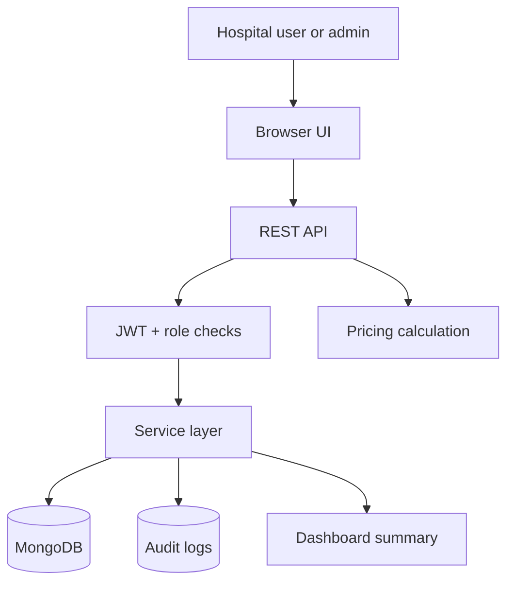

# Intern Hospital Management System Documentation Package

## Table of Contents

1. [Section 1 — Executive Architecture Overview](#section-1--executive-architecture-overview)
2. [Section 2 — Technical Architecture Document](#section-2--technical-architecture-document)
3. [Section 3 — User Manual / Operation Guide](#section-3--user-manual--operation-guide)
4. [Section 4 — Troubleshooting Runbook](#section-4--troubleshooting-runbook)
5. [Section 5 — Change Log & Doc Update Summary](#section-5--change-log--doc-update-summary)
6. [Documentation Gaps & Open Questions](#documentation-gaps--open-questions)

## What changed / Needs human review

- This package is based on the current repository state in [README.md](README.md), [compose.yaml](compose.yaml), [pom.xml](pom.xml), [src/main/resources/application.yml](src/main/resources/application.yml), and [docs/openapi.yaml](docs/openapi.yaml).
- No formal changelog or meeting notes file was supplied for the change description, so this section is a repository-based summary rather than a true release history. [NEEDS INPUT: CHANGELOG / MEETING NOTES FILE]
- The source material describes a hospital management system with patient, doctor, appointment, audit, and user-management workflows. It does not include explicit intern-registration, rotation scheduling, attendance, ward-assignment, supervision, or evaluation modules. Those items remain [NEEDS INPUT: intern-specific rules and workflow definitions].

---

## Section 1 — Executive Architecture Overview

### 1.1 Purpose and context

The system described in the project source is a hospital operations platform used to manage core care and administration activities such as login, role-based access, patient and doctor records, appointments, prescriptions, admissions, and billing. The project documentation frames it as a secure hospital management application with audit logging and role-aware access for administrators, doctors, nurses, receptionists, and patients. Evidence for this comes from [README.md](README.md), [docs/openapi.yaml](docs/openapi.yaml), and [src/main/resources/application.yml](src/main/resources/application.yml).

The repository does not yet contain the explicit workflows expected for an intern-specific system such as rotation planning, attendance tracking, task allocation, supervision workflows, or evaluation reporting. Those requirements are therefore marked as [NEEDS INPUT: intern-specific workflow definition] rather than assumed. The system as implemented is operationally aligned with a general hospital administrative system rather than a fully specialized intern management platform.

### 1.2 What the system does

The application includes the following implemented capabilities:

- Secure login with JWT-based authentication and rate limiting.
- Role-aware access control for administrators, doctors, nurses, receptionists, and patients.
- CRUD-style management of resource records such as patients, doctors, appointments, prescriptions, medical records, wards, admissions, and billing.
- Dashboard summarization with counts and recent audit activity.
- Audit logging for create, update, and delete actions with a 90-day retention setting.
- Appointment pricing calculation using a pricing strategy pattern.
- Docker-based deployment and a simple browser UI built with vanilla JavaScript.

Evidence: [README.md](README.md), [docs/openapi.yaml](docs/openapi.yaml), [compose.yaml](compose.yaml), and [pom.xml](pom.xml).

### 1.3 Key features in plain language

- Login and security: users sign in through a protected API. The backend checks credentials, issues a signed token, and limits repeated failed login attempts.
- Role-based access: each user role has different permissions. For example, administrators manage user accounts and audit logs, while doctors and nurses have access to clinical records they are allowed to update.
- Records and appointments: the system stores patient and staff information, schedules appointments, tracks treatment-related records, and supports prescription and billing tasks.
- Dashboard and visibility: managers can review summary counts and recent system activity.
- Audit trail: every significant change is tracked so administrators can see who made a change and when.

### 1.4 Technologies explained simply

The project uses a typical web application stack:

- Java 17 and Spring Boot 4 provide the backend application framework and APIs.
- Spring Data MongoDB stores data in MongoDB, which is a document database used for records and audit logs.
- Spring Security and JWT handle authentication and authorization.
- MongoDB indexes and TTL settings help with search performance and data retention.
- Docker Compose runs the backend, frontend, and database together in a local or test environment.
- HTML, CSS, and vanilla JavaScript provide the browser interface without a large frontend framework.

Evidence: [pom.xml](pom.xml), [compose.yaml](compose.yaml), [src/main/resources/application.yml](src/main/resources/application.yml), and [README.md](README.md).

### 1.5 Architecture summary and process flow

The system follows a layered pattern: the browser sends requests to the backend API, the API validates the request, the service layer handles business logic, and MongoDB stores the application data. Security checks occur at the API layer before the request is allowed through. The app also records audited actions and displays dashboard data derived from underlying records.

This architecture is consistent with the project’s layered design described in [README.md](README.md) and the REST resource definitions in [docs/openapi.yaml](docs/openapi.yaml).

### 1.6 Operational understanding for new team members

New team members should understand that this product is designed around a secure, role-based system that keeps operational data centralized and auditable. Most user interaction flows begin in the browser UI, move through authenticated API calls, and end in MongoDB records. The application is deliberately built to be understandable and modular, with separate concerns for controllers, service logic, security, and persistence.

For intern-management responsibilities, the current repository does not yet provide the definitions needed to state exact workflow behavior. That should be confirmed with hospital stakeholders before the system is presented as a full intern rotation platform. [NEEDS INPUT: rota rules, attendance policy, task assignment formats, evaluation criteria].

---

## Section 2 — Technical Architecture Document

### 2.1 System components

The application is organized into clear backend layers and supporting infrastructure:

- Frontend: browser-based UI in the frontend directory, using HTML, CSS, and JavaScript.
- Backend: Spring Boot application in the Java source tree, exposing REST endpoints under /api.
- Security layer: Spring Security with JWT handling and authorization checks.
- Persistence layer: MongoDB repositories and MongoTemplate-backed data access.
- Audit layer: dedicated audit logging and retention configuration.
- Deployment layer: Docker Compose for MongoDB, backend, and frontend containers.

Evidence: [README.md](README.md), [compose.yaml](compose.yaml), [src/main/resources/application.yml](src/main/resources/application.yml), and [docs/openapi.yaml](docs/openapi.yaml).

### 2.2 Data flow

1. A user authenticates through the /api/auth/login endpoint.
2. The backend validates the credentials and returns a JWT when the request is accepted.
3. The browser stores the token and includes it as a Bearer token in subsequent requests.
4. Controllers receive requests and delegate to the service layer.
5. The service layer applies business rules, data validation, and role-based authorization.
6. Data is persisted in MongoDB and audit records are created for lifecycle operations.
7. Dashboard and reporting endpoints aggregate data from the underlying records.

This flow is consistent with the OpenAPI definitions, the security settings, and the project architecture description in [docs/openapi.yaml](docs/openapi.yaml), [README.md](README.md), and [src/main/resources/application.yml](src/main/resources/application.yml).

### 2.3 External dependencies

The main external dependencies are:

- MongoDB 7 as the database service.
- Java 17 runtime and the Spring Boot 4 framework.
- JWT libraries for token creation and validation.
- Docker and Docker Compose for containerized deployment.
- A browser environment for the frontend UI.

Evidence: [pom.xml](pom.xml), [compose.yaml](compose.yaml), and [README.md](README.md).

### 2.4 Deployment topology

The repository supports a simple deployment topology using Docker Compose:

- MongoDB container named securecare-mongodb.
- Backend container named securecare-api running on port 8080.
- Frontend container named securecare-web running on port 5500.
- Frontend is configured to talk to the backend through the local application network and the configured frontend origin.

This is defined in [compose.yaml](compose.yaml), and the runtime settings are supplied through environment variables in [src/main/resources/application.yml](src/main/resources/application.yml).

### 2.5 Textual component diagram description

The system can be described as a three-tier application. The presentation tier is a simple browser-based interface that sends HTTP requests to the REST API. The application tier is a Spring Boot service that validates requests, enforces authorization, performs business logic, and coordinates with data access and auditing. The data tier is MongoDB, which stores records and automatically creates indexes for the configured application model. Security and access control are enforced centrally and rely on JWT tokens, while operational visibility is supported by dashboard and audit endpoints.

### 2.6 Security and operational characteristics

The project security model includes:

- JWT-based authentication.
- BCrypt password hashing.
- Role checks for protected resources.
- CORS configuration via FRONTEND_ORIGIN.
- In-memory rate limiting for login attempts.
- Audit logs with a TTL index for 90-day retention.

Evidence: [README.md](README.md), [docs/openapi.yaml](docs/openapi.yaml), and [src/main/resources/application.yml](src/main/resources/application.yml).

### 2.7 Known technical constraints or risks

1. No default JWT secret is supplied; deployment requires explicit environment configuration. Source: [src/main/resources/application.yml](src/main/resources/application.yml) and [README.md](README.md).
2. The login limiter is in-memory only, which makes it unsuitable for multi-instance deployments without a shared rate-limiting mechanism. Source: [README.md](README.md).
3. The project is explicitly described as a learning/demo foundation, not a certified clinical system. It is not yet suitable for production deployment with sensitive patient data without additional governance, encryption, access control, and compliance work. Source: [README.md](README.md).
4. The audit log TTL is asynchronous in MongoDB, so retention behavior is not immediate. Source: [README.md](README.md).
5. The source material does not yet define intern-specific scheduling, attendance, or evaluation rules; those workflows remain unimplemented or unconfirmed. Source: [prompt.txt](prompt.txt) and [README.md](README.md).

---

## Section 3 — User Manual / Operation Guide

### 3.1 Purpose and audience

This guide is designed for hospital staff and interns with basic computer skills. It explains the current operational flows represented in the source code and marks any intern-specific workflow not present in the repository as [NEEDS INPUT: workflow definition].

### 3.2 Workflow 1: Access the system and log in

1. Open the application in the browser at the configured frontend URL, typically http://localhost:5500 in local Docker deployment.
   - Expected outcome: the login screen appears.
2. Enter the username and password provided by the administrator.
   - Expected outcome: the backend validates the credentials and returns a JWT token.
3. Sign in and wait for the dashboard to load.
   - Expected outcome: the user is shown an authenticated dashboard or main application view.
4. If login fails, check the username, password, and whether the account is active.
   - Expected outcome: secure access is granted only to valid active accounts.

Troubleshooting: repeated failures may trigger rate limiting. This is documented in [README.md](README.md) and the login endpoint in [docs/openapi.yaml](docs/openapi.yaml).

### 3.3 Workflow 2: View dashboard and recent activity

1. After logging in, open the dashboard page.
   - Expected outcome: summary counts and recent activity are displayed.
2. Review counts related to the operational records available in the application.
   - Expected outcome: a quick overview of system status is visible.
3. Use the dashboard to identify whether additional record review is needed.
   - Expected outcome: staff can move quickly to the resource area requiring action.

Note: The current repository supports general dashboard summaries rather than a dedicated intern-specific rota or attendance dashboard. [NEEDS INPUT: intern dashboard fields].

### 3.4 Workflow 3: Create or update core hospital records

1. Navigate to the resource area for patients, doctors, appointments, prescriptions, or other supported records.
   - Expected outcome: the list or form for the selected resource opens.
2. Select Create, Edit, or View depending on the action required.
   - Expected outcome: the selected record or form is displayed.
3. Enter or update required values and submit the form.
   - Expected outcome: the record is persisted and returned by the API.
4. Verify the result in the list or by retrieving the record by ID.
   - Expected outcome: the information matches the intended update.

Evidence: [docs/openapi.yaml](docs/openapi.yaml) and [README.md](README.md).

### 3.5 Workflow 4: Manage appointments and pricing

1. Open the appointments section.
2. Create or edit an appointment record with the required date, doctor, patient, and duration information.
   - Expected outcome: the appointment record is stored.
3. If the system is used for estimate calculations, submit the appointment duration to the pricing endpoint.
   - Expected outcome: an estimated amount is returned.
4. Review the appointment and confirm the status update if applicable.
   - Expected outcome: the appointment status reflects the current state.

This workflow aligns with the pricing endpoint and appointment resource behavior described in [docs/openapi.yaml](docs/openapi.yaml) and [README.md](README.md).

### 3.6 Workflow 5: Review user access and audit details

1. Log in as an administrator.
2. Open the user administration area or audit logs.
   - Expected outcome: the user list or audit log is displayed.
3. Review account status, active/inactive state, and audit history.
   - Expected outcome: administrators can verify system activity and user health.
4. If a user needs to be deactivated, do so through the appropriate admin action.
   - Expected outcome: access is removed while maintaining an auditable record.

This is consistent with the admin-only controller paths in [docs/openapi.yaml](docs/openapi.yaml) and the role model in [README.md](README.md).

### 3.7 Common troubleshooting for end users

- Problem: I cannot log in.
  - Check that the username and password are correct.
  - Check whether the account is active.
  - If there were several failed attempts, wait and retry later.
- Problem: I do not see the dashboard data.
  - Refresh the page after a valid login.
  - Confirm that the server and database are reachable.
- Problem: I cannot edit a record.
  - Confirm that your role permits the action.
  - Check that the record exists and the required fields are filled.
- Problem: I cannot find a resource.
  - Verify the correct module and access permissions.
  - Review search or list filters.

### 3.8 Notes on intern-specific workflows

The repository does not currently define the following workflows in a concrete implementation:

- Intern registration
- Rotation scheduling
- Attendance capture
- Ward assignment
- Supervision and evaluation tracking
- Reporting for interns by department or unit

These items should be confirmed and mapped to actual fields and APIs before the system is used for intern operations. [NEEDS INPUT: intern workflow specification].

---

## Section 4 — Troubleshooting Runbook

| Symptom | Likely Cause | Diagnostic Steps | Fix | Escalation Path |
|---|---|---|---|---|
| Login fails with 401 or invalid credentials | Wrong password, inactive account, or missing credentials | Check the request body in the auth/login call; verify the account is active; confirm the username and password were not mistyped | Correct credentials, reactivate the account if needed, or reset the password via admin workflow | Escalate to admin or service owner if the issue affects multiple users |
| Login is rate-limited with 429 | Too many failed attempts in a short period | Review the login attempt count; confirm repeated failed sign-ins; inspect server logs for rate-limit triggers | Wait for the limiter window to expire and retry; review if a user is repeatedly attempting login | Escalate to on-call engineer if symptoms appear across many users |
| Frontend loads but API calls fail | Backend service not running, database unavailable, or CORS mismatch | Check backend health at /api/health; verify MongoDB connectivity; inspect browser network requests and frontend origin configuration | Restart backend/container; check database and environment configuration; confirm FRONTEND_ORIGIN aligns with actual frontend URL | Escalate if the service remains unhealthy after restart |
| Dashboard is empty or missing data | Data not created, backend issue, or permissions problem | Check the data records in MongoDB; inspect API responses for dashboard endpoint; confirm auth token is valid | Recreate the missing records or fix the service error | Escalate to app owner if data integrity issues are suspected |
| MongoDB connection errors | Database not running or connection string is invalid | Run docker compose ps and inspect MongoDB container health; check the MONGODB_URI and backend environment values | Restart MongoDB container or correct the connection string | Escalate to infrastructure/on-call engineer if DB fails to restart |
| User cannot access a resource despite valid login | Missing role permission or invalid data relationship | Check the user role and allowed actions; review route restrictions by resource; inspect audit and access logs | Update role or access configuration; verify record ownership and permissions | Escalate to security/admin owner for permission review |
| Audit log is missing expected entries | Missing permission, missing create/update action, or TTL retention window | Confirm the action executed through a supported API path; verify audit logging is enabled; inspect MongoDB TTL status | Reproduce the action and check logs; verify retention configuration | Escalate to application or database support if missing entries are reproducible |
| Service does not start after deployment | Missing environment variables or configuration error | Check the environment variables for JWT_SECRET, MONGODB_URI, and admin bootstrap values; check Docker logs | Correct the environment settings and restart the service | Escalate to platform engineer for persistent deployment issues |

### Diagnostic commands and operational checks

- Check container status:
  - docker compose ps
- View backend logs:
  - docker compose logs -f backend
- Check MongoDB health:
  - docker compose exec mongodb mongosh --quiet --eval "db.adminCommand('ping')"
- Check backend health endpoint:
  - curl http://localhost:8080/api/health
- Check authentication exchange:
  - curl -X POST http://localhost:8080/api/auth/login -H "Content-Type: application/json" -d '{"username":"admin","password":"YOUR_PASSWORD"}'

Source material for this section: [README.md](README.md), [compose.yaml](compose.yaml), [src/main/resources/application.yml](src/main/resources/application.yml), [docs/openapi.yaml](docs/openapi.yaml).

---

## Section 5 — Change Log & Doc Update Summary

### 5.1 Repository-based change summary

The current repository shows the following implementation state:

- Secure authentication with JWT and BCrypt has been implemented.
- Role-based access is enforced for hospital resource APIs.
- MongoDB-backed persistence and audit logging are configured.
- A Docker deployment model is present for backend, frontend, and database.
- The project includes a dashboard and a simple browser interface.
- The current source documents general hospital management workflows, rather than explicit intern-management operations.

Evidence: [README.md](README.md), [pom.xml](pom.xml), [compose.yaml](compose.yaml), [docs/openapi.yaml](docs/openapi.yaml), and [src/main/resources/application.yml](src/main/resources/application.yml).

### 5.2 Section impact summary

- Section 1: Updated to reflect the implemented hospital management capabilities and the explicit gap for intern-specific features. [NEEDS INPUT: intern workflow definitions]
- Section 2: Updated to reflect the technical stack, deployment topology, and technical risks derived from source files.
- Section 3: Updated to describe the operational flows present in the repository; intern-specific flows remain limited by missing requirements.
- Section 4: Updated with common incident scenarios and relevant operational commands.
- Section 5: Prepared from the repository state because no formal change log or meeting notes file was provided.

### 5.3 Change summary for human review

- What changed: The documentation now reflects the actual implementation state of the repository, including backend services, authentication, MongoDB, Docker deployment, and admin workflows.
- Needs human review: The intern-management requirements described in the prompt are not yet represented in the codebase. A human should confirm the exact workflow rules for intern registration, rotations, attendance, assignments, supervision, and evaluation reporting before this documentation is used as a final operational specification.

[NEEDS INPUT: CHANGELOG / MEETING NOTES FILE]

---

## Documentation Gaps & Open Questions

- Confirm the exact hospital workflow for intern registration and status lifecycle.
- Confirm rotation scheduling rules, assignment windows, and shift definitions.
- Confirm attendance tracking requirements, including validation, absence handling, and escalation rules.
- Confirm task and ward assignment rules, ownership, and approval flows.
- Confirm supervision and evaluation criteria, including scoring model and reporting cadence.
- Confirm whether the existing system should be expanded to cover these intern workflows or whether it remains a generic hospital management platform.
- Obtain the actual changelog or meeting-notes file referenced by the prompt for a precise change summary.
- Confirm the production deployment model, environment variables, and security boundaries for real hospital operations.
- Confirm whether the frontend is intended to be extended with intern-specific screens or whether the current implementation is a demo foundation only.
- Confirm the expected retention, backup, and monitoring practices for audit and clinical records.

This package is intentionally conservative: it reports only what is supported by the source material and marks any missing intern-specific requirements as [NEEDS INPUT: ...] instead of inventing unsupported details.
